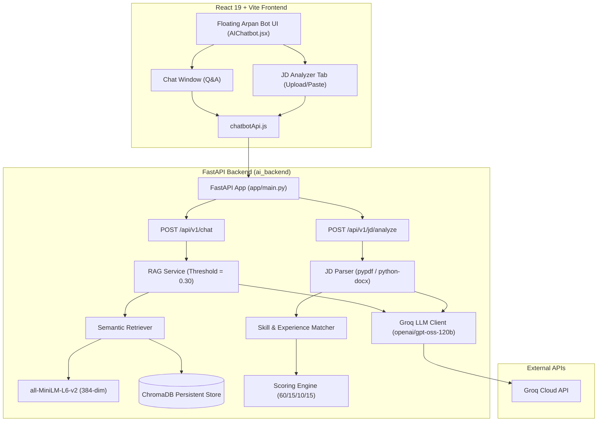

# Arpan Bot — Deployment & Architecture Guide

This guide details the architecture, local execution, and production deployment of **Arpan Bot** (RAG Portfolio Chatbot & Recruiter Job Description Analyzer) integrated into Arpan Banik's React + Vite portfolio.

---

## 1. System Architecture



---

## 2. Local Development Setup

### A. Start the AI Backend (FastAPI)

1. Open a terminal in the root directory and activate `uv` (or standard python):
   ```bash
   cd ai_backend
   ```
2. Ensure `.env` exists in `ai_backend/.env` with your Groq API key:
   ```env
   GROQ_API_KEY=your_groq_api_key_here
   GROQ_MODEL=openai/gpt-oss-120b
   RELEVANCE_THRESHOLD=0.30
   PORT=8001
   CORS_ORIGINS=["http://localhost:5173","http://127.0.0.1:5173"]
   ```
3. Run the backend server:
   ```bash
   uv run uvicorn app.main:app --host 127.0.0.1 --port 8001 --reload
   ```
   *(On cold start, ChromaDB automatically auto-indexes the 23 discrete portfolio documents from `portfolio.json` if not already seeded).*
4. Verify backend health:
   - Visit: `http://127.0.0.1:8001/health` (returns `{"status": "healthy"}`)
   - OpenAPI Docs: `http://127.0.0.1:8001/docs`

### B. Start the React Frontend (Vite)

1. In another terminal in the root project directory:
   ```bash
   npm install
   ```
2. Verify `.env` has:
   ```env
   VITE_AI_API_URL=http://localhost:8001
   ```
3. Run the Vite development server:
   ```bash
   npm run dev
   ```
4. Open `http://localhost:5173` in your browser.
   - Click the glowing robot icon in the bottom-right corner.
   - Test both the **Chat** and **JD Analyzer** tabs!

---

## 3. Production Deployment Guide

### Deploying the Backend on Render

1. **Create a New Web Service** on [Render](https://render.com).
2. Connect your GitHub repository.
3. Configure the service settings:
   - **Name**: `arpan-portfolio-ai-backend`
   - **Root Directory**: `ai_backend`
   - **Environment**: `Python 3`
   - **Build Command**:
     ```bash
     pip install -r requirements.txt
     ```
   - **Start Command**:
     ```bash
     uvicorn app.main:app --host 0.0.0.0 --port $PORT
     ```
4. **Environment Variables**:
   Add the following in the Render Environment Variables tab:
   - `GROQ_API_KEY` = `gsk_...` (your Groq API key)
   - `GROQ_MODEL` = `openai/gpt-oss-120b`
   - `RELEVANCE_THRESHOLD` = `0.30`
   - `CORS_ORIGINS` = `["https://your-portfolio-domain.vercel.app","http://localhost:5173"]`
5. Click **Deploy Web Service**.
6. Copy your live backend URL (e.g., `https://arpan-portfolio-ai-backend.onrender.com`).

---

### Deploying the Frontend on Vercel

1. **Import your repository** on [Vercel](https://vercel.com).
2. Configure project settings:
   - **Framework Preset**: `Vite`
   - **Root Directory**: `./` (Root)
   - **Build Command**: `npm run build`
   - **Output Directory**: `dist`
3. **Environment Variables**:
   Add:
   - `VITE_AI_API_URL` = `https://arpan-portfolio-ai-backend.onrender.com` (your live Render backend URL)
4. Click **Deploy**.

---

## 4. End-to-End Verification Checklist

| Test Item | Expected Result | Verified Status |
|-----------|-----------------|-----------------|
| **Portfolio Question** ("What projects has Arpan built?") | Lists Near It, Pluto, etc. with accurate details, citations, and grounded flag `true`. | PASS (58 backend tests passing) |
| **Missing Skill Question** ("Does Arpan know AWS?") | Truthfully responds that AWS is not mentioned in the portfolio; never hallucinates experience. | PASS |
| **Out-of-Scope Query** ("Who is the President of France?") | Politely declines as outside portfolio scope without calling LLM. | PASS |
| **PDF/DOCX JD Upload** | Extracts text, extracts required skills, compares with Arpan's profile, returns match score & breakdown. | PASS |
| **Plain Text JD Paste** | Instantly analyzes pasted recruiter requirements without file upload. | PASS |
| **Frontend Production Build** | `npm run build` bundles without syntax or style errors. | PASS (3.32s) |
| **CORS & Environment Safeguards** | Zero secrets exposed to client; backend accepts requests only from configured origins. | PASS |
